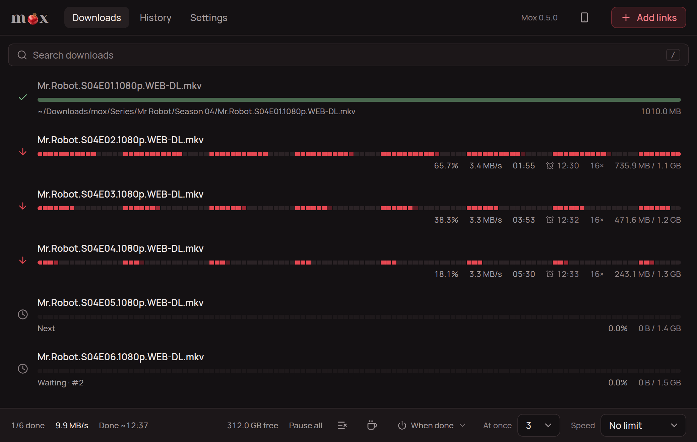

#  Mox desktop

> **Test version.** It works, and its look and features will still change. Try it, and report what goes wrong.



A desktop app for [Mox](https://github.com/moxart/moxdl), the multi-connection download manager. It is a window on Mox, not a second downloader: the app starts Mox's engine and talks to it, so every feature of Mox works here, and new ones arrive with Mox.

- Many connections per file, and a progress bar that shows which parts of the file are on disk.
- Pause, resume, and survive reboots and internet outages.
- Drag downloads into the order you want, or give one all the speed.
- Keyboard shortcuts, search, and a details panel with the piece map, the speed graph and the link.
- It learns, on your computer alone: how many connections suit each site, and how fast your internet usually is at each hour. That makes the finish time better, and it suggests the hours worth downloading in.
- When each file and the whole queue will be done, by the clock.
- Shows what it is doing outside its window too: the tray icon (downloading, paused, done), progress on the taskbar or dock icon, and the window's title.
- Made for night plans and a shaky connection: download only between certain hours, or up to so much a day; slower by day, or while someone uses the computer (the cup in the status bar); a plain note when the internet is down; quit, sleep or shut down when everything is done.
- Before it starts: the size of every link and the broken ones, a warning when they will not fit on the disk, and files you already have left out, with a question. A download that runs out of disk space waits for room instead of failing.
- After a file is done: open it, move it to a folder, or run a command on it, such as a virus scan.
- Watch a video while it downloads.
- Downloads clicked in the browser start here at once, with the site's login if you allow it. Add links from the right-click menu, by dropping them on the window or on a small floating pomegranate, by pasting, or with Ctrl+Shift+M from any program. Links copied a moment ago are offered when the window comes to the front.
- Send links from your phone: scan a QR code, and a page on your Wi-Fi adds links and shows the downloads.
- Series sorted into a folder per show and season.
- History with a chart of the last 30 days, and the same settings as `mox config`.
- A short welcome on the first run: language, look, the browser extension, a night plan.
- Lives in the tray, and can start with the computer.
- Updates itself: it offers a new version, and installs it when you say so.
- In English or Persian, dark or light.

Built with Tauri 2, React and Tailwind. Linux, Windows and macOS.

## Install

From a [release](https://github.com/moxart/moxdl-desktop/releases), on Linux:

```bash
sudo apt install ./Mox_0.5.0_amd64.deb      # Debian, Ubuntu
chmod +x Mox_0.5.0_amd64.AppImage && ./Mox_0.5.0_amd64.AppImage   # any distribution
```

On Windows run `Mox_0.5.0_x64-setup.exe`; on a Mac open `Mox_0.5.0_aarch64.dmg` (Apple silicon) or `Mox_0.5.0_x64.dmg` (Intel). The installers are not signed yet, so Windows shows a SmartScreen warning (More info → Run anyway), and macOS needs a right-click → Open the first time.

Mox is built into the app, so nothing else is needed: no Python, no separate install.

## From the browser

The extension in [`browser-extension/`](browser-extension) takes over the browser's downloads and sends them to Mox, as IDM does, where they start at once. Files the browser knows to be under 1 MB stay with the browser, and so does a download you start again within a minute of handing it to Mox: that is the way to let the browser have one. Its toolbar button turns this off and on.

It also adds three items to the right-click menu of Firefox and Chrome: **Download with Mox** on a link, one for the links in selected text, and one for every file link on the page, such as a folder listing.

How it reaches the app:

- The app listens on `127.0.0.1` (ports 6691 to 6693) for browser extensions alone: it checks each request's `Origin`, which a web page cannot fake, and its `Host`, against DNS rebinding. Links sent there start at once, with the browser's Referer and User-Agent.
- With **Send cookies** on, in the extension's options, the site's cookies go along too, so a download that needs a login works. The browser asks for that permission once; cookies go only to Mox on this computer, only for the download's own site, and never from a private window. Mox keeps its list readable by your user alone, since it can hold them.
- When the app is not running, the extension opens a `mox://` link instead, which starts it. Since any web page can open such a link, those links wait in the add dialog until you press Download.

The installers carry the extension; the welcome on the first run shows its folder. To load it:

- **Chrome, Edge, Brave:** open `chrome://extensions`, turn on Developer mode, press Load unpacked, and pick the `browser-extension` folder.
- **Firefox 128 or later:** open `about:debugging#/runtime/this-firefox`, press Load Temporary Add-on, and pick `browser-extension/manifest.json`. It stays until Firefox restarts; for good it needs signing by Mozilla.

`npm run extension` zips it for a store.

## Build it

You need Node, Rust, Python 3.8 or newer, and on Linux the libraries Tauri uses:

```bash
sudo apt install libwebkit2gtk-4.1-dev libxdo-dev libssl-dev libayatana-appindicator3-dev librsvg2-dev
```

With the [Mox repository](https://github.com/moxart/moxdl) checked out next to this one, as `../moxdl`:

```bash
npm install
npm run tauri dev       # the app, using ../moxdl/mox.py, so changes to Mox show at once
npm run package         # installers in src-tauri/target/release/bundle/
```

`npm run package` first builds Mox into one executable with PyInstaller (`scripts/build-engine.sh`, in a venv of its own), then puts it in the installers.

The app finds Mox in this order: the `MOX_ENGINE` variable (a whole command, such as `python3 /path/to/mox.py`); in a development build, `../moxdl/mox.py`; the Mox built into the app; `mox` on the PATH (version 1.8 or newer).

## Change the look

```bash
npm run dev
```

opens the interface in a browser at http://localhost:1420 with a pretend engine and made-up downloads that move, so every state shows. No Rust build, and every edit appears at once.

- **Colors, corners and fonts** are all in [`src/theme/tokens.css`](src/theme/tokens.css). Components only use the names defined there (`bg-surface`, `text-muted`, `rounded-card`…), so changing a value restyles everything that uses it.
- **Each part of the window** is its own file in [`src/components/`](src/components): a download's row, the piece-map bar, the add dialog, the dropdowns, the status bar, history, settings.
- **The icon** is made from [`app-icon.png`](app-icon.png), 1024 px with a transparent background: `npx tauri icon app-icon.png` makes every size.

## How it fits together

```
React (src/)  ⇄  Tauri shell (src-tauri/src/lib.rs)  ⇄  mox engine (mox.py)
     events and commands        JSON lines on stdin and stdout
```

- `src-tauri/src/lib.rs` starts the engine, sends the interface's commands to it and passes its events back. Closing the window asks Mox to save every download's progress first.
- `src/engine/` holds the protocol's types, the `useEngine` hook that keeps the app's state, and the browser demo.
- The protocol itself is documented on `Engine` in mox.py.

## Not done yet

- Signed installers, so Windows and macOS stop warning about them.
- The extension in the Chrome Web Store and on addons.mozilla.org.
- Ctrl+Shift+M and the floating pomegranate under Wayland, which lets no program take a key for itself or keep a window on top.
- Reading the clipboard while the window is in the background: on Wayland that takes focus for a moment, so links are offered when the window comes to the front instead.

## License

MIT
